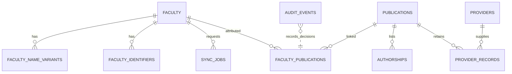

# FRIS relational model

The PostgreSQL schema uses UUID primary keys, foreign keys, timestamps, soft status fields and migrations. `institutional_email` is stored on `faculty` but excluded from public response schemas and CSV export.

- `faculty_publications` stores the match score, match status, explainability evidence, and reviewer decision for one faculty/publication pair.
- `publications.doi_normalized` is nullable and unique when present. Publications without DOI remain separate unless the deduplication owner has grouped them before persistence.
- `provider_records` has a unique `(provider_id, external_record_id)` pair, linking original provider provenance to a canonical publication.
- `audit_events` is append-only through the API. Review decisions record actor role, prior/new status and reason.
- `sync_jobs` stores request parameters, per-provider status and error summary so partial source failures can be reported independently.
